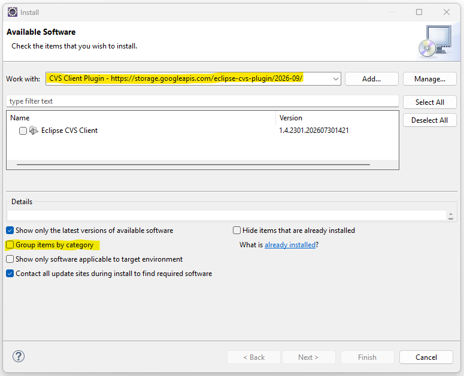

# Eclipse CVS Client

This is the original Eclipse CVS Client plugin extracted from the now empty [eclipse.platform.team](https://github.com/eclipse-platform/eclipse.platform.team) repository. The Eclipse Team stopped maintaining the plugin and removed it from the Eclipse code base in 2022. The rest of the Eclipse Team sources were moved to [Eclipse core](https://github.com/eclipse-platform/eclipse.platform). This git repository is a copy of the eclipse.platform.team repository so it preserves the commits history of the plugins sources.

Update site URL: `https://storage.googleapis.com/eclipse-cvs-plugin/2026-09`

## Eclipse 4.42 compatibility

CVS now retains the Team implementation classes removed from Eclipse 4.42 in
its own internal packages. See [compatibility notes](docs/eclipse-4.42-compatibility.md)
for details and local verification instructions.
